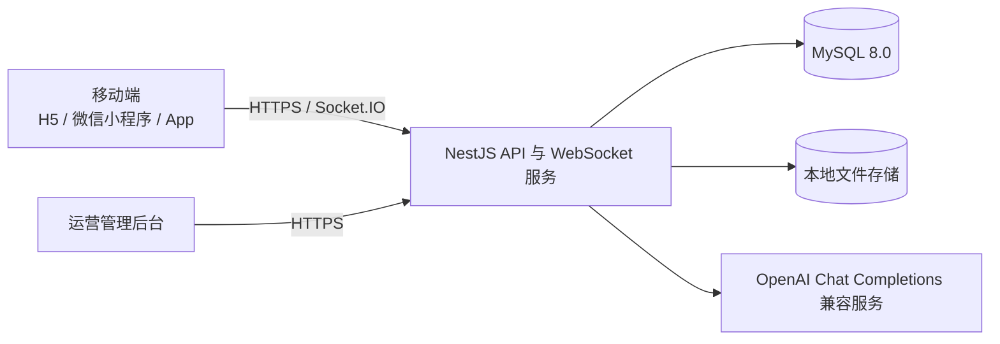

# 家庭动态小助手项目功能介绍

## 一、项目概述

家庭动态小助手是一套面向家庭生活记录与社区互动的全栈应用，包含移动端社区、运营管理后台和统一后端服务。用户可以发布图文或视频动态、浏览社区内容、互动评论、关注好友、进行一对一聊天，并可使用带历史上下文的 AI 对话。运营人员可以在管理后台完成内容审批、动态管理、C 端用户审核、广告投放管理和 AI 能力配置。

项目当前由三个可独立构建的应用组成：

| 应用 | 目录 | 主要使用方 | 技术栈 |
| --- | --- | --- | --- |
| 移动端 | `mobile/` | C 端用户 | uni-app、Vue 3、TypeScript、Pinia、SCSS、Socket.IO Client |
| 管理后台 | `admin/` | 运营与管理员 | Vue 3、TypeScript、Pinia、Vue Router、Element Plus、ECharts、Webpack 5 |
| 后端服务 | `server/` | 两个前端应用 | NestJS、TypeORM、MySQL 8.0、Socket.IO、Swagger |

移动端支持 H5、微信小程序和 Android App 构建。管理后台与移动端使用独立的账号和 Token 体系，权限互不通用。

## 二、项目定位

项目围绕“生活内容记录 + 社区社交 + AI 辅助创作 + 后台运营审核”构建完整闭环：

1. 用户通过手机号登录，首次登录时自动注册。
2. 用户发布图文或视频动态，内容进入待审批队列。
3. 运营人员审批通过后，动态展示在社区首页。
4. 用户可以点赞、收藏、评论、分享、关注其他用户，并与好友聊天。
5. 用户可以通过 AI 对话获得建议，也可以在发布动态时使用 AI 生成文案。
6. 管理员维护模型、Skills、广告计划和用户权限，并查看业务数据。

## 三、系统组成



### 移动端

面向 C 端用户，提供内容浏览、动态发布、社交互动、消息通知和 AI 对话等能力。

### 管理后台

面向运营和管理员，提供论坛审核、用户管理、广告管理、数据看板、内容预览和 AI 配置能力。

### 后端服务

提供统一 REST API、移动端与后台端分隔鉴权、动态路由、WebSocket 实时能力、文件上传和 AI 服务适配。

## 四、移动端功能

### 1. 账号与个人资料

- 手机号和密码登录，未注册手机号会自动创建 C 端账号。
- Access Token 与 Refresh Token 登录状态管理，支持令牌续期和退出登录。
- 展示个人资料、关注数、粉丝数和动态数。
- 编辑姓名、性别、手机号、生日、城市、邮箱和个性签名。
- 支持默认头像选择和本地头像上传。
- 支持 H5、微信小程序和 App 多端运行。

### 2. 社区动态

- 首页以双列瀑布流展示已审核且启用的动态。
- 支持标题搜索、下拉刷新、滚动分页和空状态展示。
- 卡片展示封面、标题、作者和点赞数。
- 动态详情支持图文与视频素材浏览。
- 支持点赞、取消点赞、收藏和取消收藏。
- 支持评论、回复和评论排序，评论可按最高点赞、最新或最多评论排列。
- 支持关注或取消关注动态作者。
- 支持分享动态，并记录分享行为。
- 提供“我的喜欢”“我的收藏”和个人动态记录列表。

### 3. 动态发布

- 支持上传最多 9 个图片或视频素材。
- 支持填写动态标题和正文。
- 支持调用多模态 AI，根据图片或已有内容生成动态文案。
- 素材统一上传到后端本地文件服务后再提交动态。
- 新动态默认进入待审批状态。
- 用户可以查看待审批、已通过和已驳回的动态记录。

### 4. 社交关系

- 按昵称搜索用户，并展示推荐用户。
- 用户主页展示资料、动态和关注状态。
- 支持关注、取消关注、关注列表和粉丝列表。
- 互相关注的用户进入好友列表。
- 支持从好友资料发起聊天或浏览对方动态。

### 5. 私信聊天

- 展示当前用户的一对一会话列表。
- 支持查看最后一条消息、时间和未读数量。
- 支持会话置顶、取消置顶和删除会话。
- 支持进入聊天页查看历史消息并发送消息。

### 6. 消息通知

- 支持点赞、评论、关注和系统消息等通知类型。
- 展示未读数量，并支持单条已读、全部已读、单条删除和全部清空。
- 通过 Socket.IO 接收新通知并实时更新未读数。
- 通知可以跳转到对应动态或用户页面。

### 7. AI 中控

- 支持与 AI 助手进行连续对话。
- 通过 WebSocket 流式接收回答，消息逐段展示。
- 自动保留会话与消息历史，支持打开历史问答。
- 支持新建会话、删除单个会话和清空全部历史。
- 服务端会组合模型 System Prompt、启用技能和对话上下文后调用模型。
- 当前预置 DeepSeek 模型，接口兼容 OpenAI Chat Completions 格式。

## 五、管理后台功能

### 1. 登录与权限

- 管理员账号密码登录，Access Token 过期后静默刷新。
- 后端按角色返回可访问路由，前端动态挂载菜单和页面。
- 越权页面显示 403，不存在的页面显示 404。
- 支持个人资料编辑和密码修改。
- 管理后台与 C 端账号、Token 和数据表相互隔离。

### 2. 运营工作台

- 展示运营概览指标和趋势信息。
- 提供后台业务导航、面包屑和深浅主题支持。
- 公共表格、查询面板、图表、状态标签、媒体预览等组件统一封装。

### 3. 论坛内容管理

- 论坛信息审批：待审动态查询、单条通过、批量通过、驳回和审批详情。
- 论坛动态：全量查询、真实互动数据展示、下架、重新上架、删除和批量删除。
- 动态类型：新增、查询、修改和删除类型，类型名称变更可同步到关联动态。
- 变更记录：记录动态编辑、审批、下架、启用等操作及备注、附件和时间。
- 动态预览：读取真实动态和动态类型，支持图集与视频大图预览。

### 4. C 端用户管理

- 按审核状态、VIP 等级和启停状态筛选用户。
- 查看 C 端用户资料和账号详情。
- 审批用户资料，支持通过和驳回。
- 启用或禁用账号，驳回用户资料后账号自动禁用。

### 5. 广告推广管理

- 创建、编辑、删除和查询广告投放计划。
- 维护广告对接方类型、对接文档、Key 字段和集成地址。
- 展示预算、消耗进度、投放状态等信息。
- 支持广告计划启停和状态流转。
- 已预置巨量引擎、腾讯广告、百度营销、快手磁力引擎、小红书聚光、阿里妈妈、Google Ads、Meta Marketing API 和 TikTok Ads API 等对接方类型。

### 6. 数据分析

- 用户行为分析页面支持活跃趋势、行为漏斗以及设备、地域、时段分布。
- 支持 7 天、14 天和 30 天范围切换。
- 当前后端尚未提供行为统计接口，该页面由前端 mock 数据兜底。

### 7. AI 配置

- 模型管理：维护服务商、模型名称、Base URL、API Key、System Prompt、生成参数、启用状态和默认模型。
- Skills 管理：上传 Markdown 技能文件，或根据技能名称、描述和指令生成模板。
- 技能编辑：内置 Markdown 编辑器，支持工具栏、编辑与预览切换、行列统计和同名文件覆盖。
- 模型与技能关联：为模型选择启用的技能，调用时追加技能 Markdown 内容作为提示词。
- 支持技能文件上传、下载和本地文件仓归档。
- 提供 AI 调用记录、用量趋势、额度账户和额度刷新能力。

## 六、后端服务功能

### 1. 账号与鉴权

- 管理后台登录、刷新、退出和个人信息接口。
- 移动端手机号登录、自动注册、刷新、退出和资料维护接口。
- Token 使用 SHA-256 哈希存储，支持限制单个账号的活跃 Token 数量。
- 管理端 `TokenAuthGuard` 与移动端 `MobileAuthGuard` 分离。
- WebSocket AI 对话和通知连接同样校验移动端 Token。

### 2. 权限与路由

- 角色、管理员用户和后台路由管理。
- 角色通过路由 ID 数组配置可见页面。
- 后端返回路由树，前端根据当前用户权限生成菜单与页面。

### 3. 社区内容

- 动态创建、查询、编辑、审批、上下架和删除。
- 动态类型和变更日志管理。
- 点赞、收藏、评论、回复、分享和个人内容列表。
- 动态通知生成、未读统计、已读操作和 WebSocket 推送。
- 管理端与 C 端使用不同的动态读写接口和鉴权守卫。

### 4. 社交与私信

- 用户搜索、用户资料和用户动态接口。
- 关注、取消关注、关注列表、粉丝列表和互关好友列表。
- 一对一私信会话、消息、置顶和删除能力。

### 5. AI 能力

- 模型配置和 Skills 管理。
- 连续会话、历史消息、消息删除和会话清理。
- WebSocket 流式对话。
- 文本附件概述和多图片一次性问答。
- OpenAI Chat Completions 兼容适配，可配置 DeepSeek 或其他兼容服务商。
- AI 用量记录、趋势统计、额度查询和额度刷新。

### 6. 文件与基础能力

- 通用文件上传和移动端头像上传。
- 按图片、视频、音频、文档、压缩包和其他类型归档。
- 文件按上传日期和自定义子目录存储，支持静态访问。
- 统一响应结构、业务异常处理、分页约定和 Swagger 文档。
- 健康检查、MySQL 数据库连接和本地静态文件托管。

## 七、典型业务流程

### 动态发布与审核

```text
用户选择图片/视频
  -> 调用文件上传接口
  -> 可选：调用 AI 生成文案
  -> 提交动态，状态为待审批
  -> 管理员审批通过或驳回
  -> 审批通过且启用的动态进入移动端首页
```

### 用户互动

```text
浏览动态
  -> 点赞 / 收藏 / 评论 / 分享
  -> 关注作者
  -> 互相关注后成为好友
  -> 发起私信聊天
  -> 接收互动通知
```

### AI 对话

```text
移动端建立已鉴权 WebSocket
  -> 发送问题
  -> 服务端读取模型配置、System Prompt 和关联 Skills
  -> 调用兼容 Chat Completions 的模型服务
  -> 流式返回回答
  -> 保存会话、消息和用量记录
```

### 技能文件配置

```text
管理员创建或上传技能
  -> Markdown 文件上传到本地文件仓
  -> 保存技能记录和文件地址
  -> 将技能关联到模型
  -> AI 调用时读取技能内容并加入系统提示词
```

## 八、目录说明

```text
.
├─ admin/                 # Vue 3 运营管理后台
│  └─ src/
│     ├─ api/             # 后台接口封装
│     ├─ components/      # 通用表格、图表、审批、媒体预览等组件
│     ├─ router/          # 固定路由、动态路由和权限守卫
│     ├─ stores/          # 用户、权限和应用状态
│     └─ views/           # 工作台、论坛、用户、广告、分析、AI 等页面
├─ mobile/                # uni-app 多端社区应用
│  └─ src/
│     ├─ api/             # 移动端接口和 Socket.IO 封装
│     ├─ components/      # AI、动态、聊天、好友、个人中心等面板
│     ├─ pages/           # 登录、发布、详情、聊天、资料等页面
│     ├─ stores/          # 移动端用户状态
│     └─ static/          # 导航图标、功能图标和其他静态资源
├─ server/                # NestJS 后端
│  ├─ src/
│  │  ├─ auth/            # 管理端鉴权
│  │  ├─ mobile-auth/     # 移动端鉴权
│  │  ├─ users/           # 管理员用户
│  │  ├─ roles/           # 角色与权限
│  │  ├─ routes/          # 后台动态路由
│  │  ├─ customers/       # C 端用户审核
│  │  ├─ forum/           # 动态、评论、互动、通知
│  │  ├─ social/          # 关注、好友和私信
│  │  ├─ ads/             # 广告计划与对接方
│  │  ├─ ai/              # 模型、技能、对话、用量与额度
│  │  └─ files/           # 文件上传
│  └─ sql/                # 数据库表结构和初始化数据
├─ docs/                  # 专项设计与集成方案
├─ package.json           # 仓库级启动、构建和检查命令
└─ README.md              # 基础启动说明
```

## 九、运行说明

### 前置条件

- Node.js 20 或更高版本。
- MySQL 8.0。
- 管理后台使用 pnpm。
- 后端使用 npm。
- 本地文件上传需要准备可写目录，并在 `server/.env` 中配置 `LOCAL_FILE_ROOT`。
- AI 对话需要为模型配置有效的 API Key，或在 `server/.env` 中配置 `DEEPSEEK_API_KEY`。

### 安装依赖

```powershell
pnpm -C admin install
pnpm -C mobile install
npm --prefix server install
```

### 启动服务

```powershell
# 管理后台
pnpm run dev:admin

# 移动端 H5
pnpm run dev:h5

# 微信小程序
pnpm run dev:wx

# 后端 API
pnpm run dev:server
```

默认地址：

- 后端 API：`http://localhost:3000/api`
- Swagger：`http://localhost:3000/swagger/docs`
- 健康检查：`http://localhost:3000/api/health`

管理后台演示账号：

| 账号 | 密码 | 角色 |
| --- | --- | --- |
| `admin` | `123456` | 超级管理员 |
| `user` | `123456` | 普通用户 |

### 构建与检查

```powershell
npm run build:admin
npm run build:mobile:h5
npm run build:mobile:mp-weixin
npm run build:mobile:app
npm run build:server

npm run typecheck:admin
npm run typecheck:mobile
npm run lint:admin
npm run lint:mobile
npm run verify:mobile
npm run smoke:admin
```

## 十、当前状态与注意事项

- 登录、动态、审核、C 端用户、广告、社交、私信、通知、AI 和文件模块均已接入真实后端接口。
- “用户行为分析”是当前唯一仍使用前端 mock 数据的业务页面。
- 动态素材目前支持真实上传和本地文件地址；部分历史演示数据可能使用确定性占位素材。
- 本地文件删除技能记录时不会级联删除磁盘文件，需要另行清理文件仓。
- 数据库默认关闭 TypeORM 自动同步，表结构变更应通过 `server/sql` 或迁移脚本管理。
- 管理端和移动端必须使用各自账号登录，Token 不能跨端调用。
- AI 模型、技能和提示词会在服务端组合，前端不会直接持有模型 API Key。
